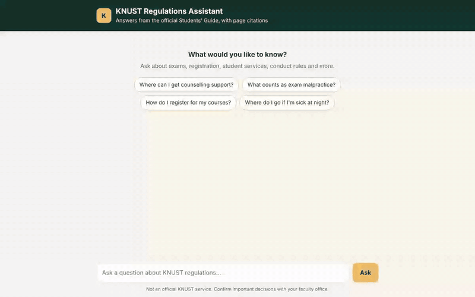

# KNUST Regulations Assistant

A retrieval-augmented generation (RAG) assistant that answers KNUST students' questions about university regulations from the official **KNUST Students' Guide and Code of Conduct (2023)**. Every answer cites the PDF page it came from, and the assistant says "I don't know" when the guide doesn't cover the question.

**Live demo:** https://knust-rag.onrender.com (free tier: the first visit after a quiet period can take about a minute to wake up)



The project is built around measurement: a reviewed 92-question eval set, automatic scoring, and experiments comparing retrieval methods, chunk sizes and models.

## How it works

```
question → retrieve top-k chunks (vector | BM25 | hybrid) → LLM with numbered sources → answer + [n] citations
```

| Part | File | What it does |
| --- | --- | --- |
| Ingestion | `src/ingest.py`, `src/embed.py` | PDF → cleaned text per page → overlapping word-window chunks that remember their pages → embedded with `BAAI/bge-small-en-v1.5` (fastembed, ONNX) → `data/index/` |
| Retrieval | `src/retrieve.py` | Dense vector search (NumPy dot product over the saved vectors), BM25 keyword search, or hybrid (reciprocal rank fusion) |
| Answering | `src/answer.py` | Strict prompt: sources only, cite every claim, refuse when unsupported; parses `[2]`, `[1, 4]` and `[1][3]` citation styles |
| LLM client | `src/llm.py` | Any OpenAI-compatible endpoint, set in `.env`; 60 s timeout with automatic retries on rate limits and server errors |
| API + UI | `app/main.py`, `app/static/index.html` | FastAPI app and chat interface (see below) |
| Evaluation | `eval/` | Question drafting, review export, and a resumable scoring runner |

The default model is **Gemini 3.1 Flash-Lite** through Google's OpenAI-compatible endpoint. OpenAI, Groq or a local Ollama model work by changing three lines in `.env`.

## Chat interface

- **Clickable citations.** The `[n]` markers in an answer and the page tags under it open the source passage (the ~110 words of the retrieved chunk that best match the answer) with a link that opens the PDF at that page.
- **Feedback.** Each answer has thumbs up/down. A thumbs-down can carry a short comment. Feedback is appended to `data/feedback.jsonl` (git-ignored); thumbs-down rows are candidates for new eval questions.
- **Streaming answers.** The answer appears word by word as the model writes it (via `/ask/stream`), so the first words show up as soon as the model starts instead of after the whole answer. Bold text and bullet/numbered lists are rendered with a small DOM-based markdown renderer (model text is never inserted as HTML). Citations, sources and feedback attach once the answer is complete.
- **Loading state.** Animated typing dots and a status line that changes the longer a request takes, so slow free-tier responses don't look frozen.
- **Theme.** Deep green `#0F372F` and gold `#ECBC6B`, with a dark mode that follows the system setting.

| Endpoint | Purpose |
| --- | --- |
| `GET /` | Chat page |
| `POST /ask` | `{"question": "..."}` → answer, citations (with excerpts), retrieved chunks, latency, tokens |
| `POST /ask/stream` | Same input; streams NDJSON lines: `{"type": "delta", "text"}` pieces, then `{"type": "done", ...}` with the same fields as `/ask` (plus `first_token_s`), or `{"type": "error", "detail"}` |
| `GET /docs-pdf/{name}` | Serves an indexed PDF from `data/raw/` (nothing else), or redirects to the official public copy when the PDF isn't on the server, e.g. `/docs-pdf/students_guide_2023.pdf#page=78` |
| `POST /feedback` | `{"question", "answer", "rating": "up" or "down", "comment"}` |

## Deployment (Render free tier)

The server is kept small enough for Render's free plan (512 MB RAM): `requirements.txt` has no PyTorch and no vector database. Embeddings come from fastembed (ONNX Runtime), which gives the same `bge-small-en-v1.5` vectors as sentence-transformers (cosine 1.00000 on every chunk; retrieval hit@10 unchanged at 88.6%), and the index is a NumPy file committed in `data/index/`. Measured locally with only the server requirements: **~295 MB peak memory** with the model and index loaded, ~60 ms per retrieval.

1. Push the repo to GitHub.
2. In Render: **New → Blueprint**, pick the repo. `render.yaml` sets the build (`pip install -r requirements.txt && python -m src.embed`), start command, health check and settings.
3. When asked, paste your `LLM_API_KEY`. It stays in Render's dashboard and is never committed.
4. Open the `onrender.com` URL once the deploy is live.

Free-tier behaviour to know about:
- The service sleeps after 15 minutes without traffic; the next visit takes about a minute to wake it.
- The disk is wiped on restart, so `data/feedback.jsonl` doesn't persist there.
- Citation links redirect to the official KNUST copy of the PDF, since the PDF isn't in the repo.
- `/ask` and `/ask/stream` are limited to `ASK_RATE_LIMIT` questions per minute per visitor (default 8) so a public link can't use up the API quota.
- Gemini's free tier quota is **per model per project per day**: 500 requests for `gemini-3.1-flash-lite`, but only 20 for `gemini-3.6-flash`. One full eval run uses about 180 requests (an answer plus a judge call per question), and the live app shares the same quota, so heavy eval days can make the live app return "daily limit reached" until the quota resets (midnight Pacific time). The live app uses `gemini-3.1-flash-lite`, the model all results above were measured with. `/debug/llm` makes one test call and shows the provider's exact error (with a hash of the key, never the key) if something is wrong.

## Setup

Requires Python 3.10+.

```bash
./setup_env.sh                    # creates .venv, installs requirements-dev.txt, downloads the embedding model
cp .env.example .env              # then add your API key, base URL and model
source .venv/bin/activate
```

Example `.env` for Gemini:

```
LLM_BASE_URL=https://generativelanguage.googleapis.com/v1beta/openai/
LLM_API_KEY=your-key-here
LLM_MODEL=gemini-3.1-flash-lite
```

`.env` is git-ignored, so your key never reaches GitHub.

Download the [2023 Students' Guide PDF](https://www.knust.edu.gh/sites/default/files/2023-06/Students%27%20Guide%20and%20Code%20of%20Conduct.pdf) into `data/raw/students_guide_2023.pdf`, then:

```bash
python -m src.ingest                                    # rebuild the index (226 pages → 257 chunks at the default 300 words)
python -m src.answer "Where can I get counselling support?"
uvicorn app.main:app --reload                           # chat UI at http://localhost:8000
python -m pytest -q                                     # unit tests
```

## Evaluation

### The eval set

`eval/questions.jsonl` holds **92 questions: 79 answerable and 13 unanswerable**. They were built in three steps:

1. **Drafted** by `eval/generate_questions.py`: one student-style question per randomly sampled page, so each question's source page is known exactly, plus 15 questions the guide shouldn't answer.
2. **Reviewed by hand** in `eval/candidates.csv`: each row marked `keep`, `edit` or `drop`. 8 of 100 drafts were dropped.
3. **Exported** with `python -m eval.build_eval`, which only includes reviewed rows.

Page numbers are **PDF page numbers** (what a PDF viewer shows), not the numbers printed on the pages, which run about 19 lower.

### Running it

```bash
python -m eval.run_eval --retrieval-only --tag retr-vector     # free and fast: retrieval only, no LLM calls
python -m eval.run_eval --tag baseline-vector-600              # full run: answers + LLM judge
RETRIEVAL_MODE=hybrid python -m eval.run_eval --tag hybrid-600
CHUNK_SIZE=300 python -m src.ingest && python -m eval.run_eval --tag vector-300
```

Runs are **resumable**: every scored question is saved to `eval/results/<tag>.partial.jsonl` as it finishes. Re-running with the same `--tag` skips completed questions and retries any that errored, so a provider outage never loses work. Each finished run appends a summary line to `eval/results/summary.jsonl`.

### Metrics

| Metric | Meaning |
| --- | --- |
| Hit@5 | The question's source page is among the 5 retrieved chunks |
| Accuracy | An LLM judge rates the answer correct on the main point compared with the reference answer (secondary details may be omitted) |
| Citation correctness | A cited chunk contains the source page |
| Refusal accuracy | Unanswerable questions get "I don't know" |
| Latency | Seconds from question to answer (p50 / p95) |

## Results

### Retrieval only (79 answerable questions, top 5, 600-word chunks)

| Retrieval | Hit@5 |
| --- | --- |
| Vector | **75.9%** |
| Hybrid (vector + BM25) | 72.2% |
| BM25 (keyword) | 60.8% |

Plain vector search did best. The questions are paraphrased in a student's own words, so keyword matching struggles, and fusing it with vector search slightly lowers the result.

### End to end

92 questions (79 answerable, 13 unanswerable), vector retrieval, Gemini 3.1 Flash-Lite. Hit@k uses k = the number of chunks retrieved.

| Config | Hit@k | Accuracy | Citations | Refusals | Wrong refusals | p50 / p95 latency |
| --- | --- | --- | --- | --- | --- | --- |
| Baseline: 600-word chunks, top 5, prompt v1 | 75.9% | 83.5% | 67.1% | 92.3% | 8 | 5.1 s / 21.1 s |
| 600-word chunks, top 5, prompt v2 | 75.9% | 87.3% | 69.6% | 92.3% | 6 | 2.6 s / 5.5 s |
| **300-word chunks, top 10, prompt v2 (current default)** | 88.6% | **87.3%** | **79.7%** | 84.6% | **2** | 4.1 s / 6.1 s |

**Prompt v2** answers whenever the sources support an answer, even partially, and refuses only when nothing retrieved is relevant. Against v1 it fixed 3 answers and broke none, with no change on unanswerable questions. Both prompts are in `src/answer.py`; choose with `PROMPT_VERSION`.

**300-word chunks with top 10** give the model the same amount of text as 5 × 600 words, but in finer pieces. Accuracy is the same, but answers are much better grounded: citation correctness rose 10 points and wrong refusals fell from 6 to 2. For example, the "how many members does a new club need?" question now finds the exact sentence (750 members), which the 600-word setup missed because it sat in a neighbouring chunk. The cost is two unanswerable questions now get answers instead of refusals. Both are borderline (changing courses after the portal closes, and reporting bullying), and the answers quote relevant rules from the guide rather than inventing anything.

**Run-to-run variation is negligible.** A repeat of the 600-word v2 run (answers at temperature 0, same judge) gave identical results question by question: 69/79 correct both times, 0 answers flipped, the same 6 wrong refusals (87.3% accuracy; citations 69.6% vs 70.9% because two near-tied chunks swapped order). So the differences between configurations above are real, not noise. The two v2 configurations have the same accuracy but fail on different questions (6 fixed, 6 newly wrong by the 300-word setup). Latency differences between rows mostly reflect load on the free API tier.

### Chunk size (retrieval only, top 5)

| Chunk size (words) | Chunks | Hit@5 |
| --- | --- | --- |
| 300 | 257 | 72.2% |
| **600** | 129 | **75.9%** |
| 1000 | 77 | 72.2% |

Hit@5 checks whether a retrieved chunk's *pages* include the source page, which favours large chunks that span many pages, and here 300-word chunks also got half the total text. This table therefore understates small chunks; the end-to-end comparison above (10 × 300 vs 5 × 600 words) is the fair one.

### What the baseline shows

Breakdown of the 79 answerable questions:

| Outcome | Count |
| --- | --- |
| Source page retrieved, answer correct, citation correct | 52 |
| Source page **not** retrieved, but answer still correct | 12 |
| Source page retrieved, answer correct, but it cited a different chunk | 2 |
| Wrongly refused ("I don't know") although the answer was in the guide | 8 |
| Answered, but wrong | 5 |

- **The citation metric is stricter than it should be.** Each question is labelled with the single page it was drafted from, but the guide repeats many facts on other pages (for example, accommodation and security contacts). In 12 cases the assistant answered correctly from a different page, which counts as a citation miss (most of the gap between 83.5% accuracy and 67.1% citation correctness). Labelling questions with every page that answers them would make the metric fairer.
- **Over-refusal is the main answer error.** 8 of 79 answerable questions got "I don't know". In 4 of those the right page *was* retrieved, so the prompt is making the model too cautious. The other 4 are retrieval misses.
- **Refusals on unanswerable questions work.** 12 of 13 were correctly refused. The one exception asked about reporting bullying, which the guide's harassment section partly covers, so the question itself is borderline.
- **Latency is dominated by the free API tier.** The median is about 5 s, but busy periods push the slowest 5% past 20 s.

## Project structure

```
app/            FastAPI app and chat page
src/            config, ingestion, retrieval, LLM client, answering
eval/           question generation, review export, eval runner, questions.jsonl
tests/          unit tests
data/index/     chunks + embeddings per chunk size (committed, so servers don't rebuild)
data/raw/       source PDFs (not committed)
setup_env.sh    one-time environment setup
render.yaml     Render deployment blueprint
```

## Limitations

- Answers are only as current as the indexed PDF. Some regulations, such as detailed exam rules, may live in documents not yet included.
- Most eval questions were drafted by an LLM from the guide, then reviewed by hand. Drafted questions can echo the guide's wording, which may make retrieval look better than it would on real student questions.
- Answer accuracy is scored by an LLM judge, which was checked on sample right and wrong answers but can still make mistakes.
- Latency figures come from a free API tier and vary with provider load.
- Not an official KNUST service. Confirm important decisions with your faculty office.

## License

The code is released under the [MIT License](LICENSE).

The KNUST Students' Guide and the text taken from it (including the chunks in `data/index/`) belong to KNUST and are not covered by this license. They are included only so the assistant can cite them. The official PDF is available from [knust.edu.gh](https://www.knust.edu.gh/).
